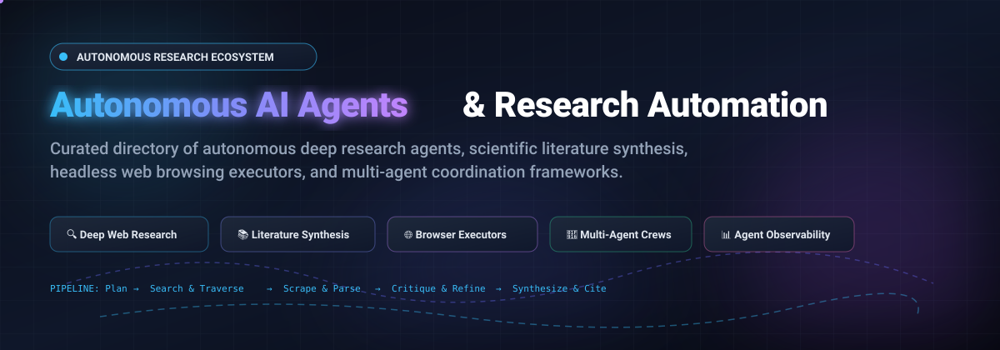

# 🤖 Awesome-Autonomous-AI-Agents-Research-Automation

<div align="center">



<p align="center">
  <a href="https://github.com/ishandutta2007/Awesome-Awesome-Awesome"></a>
  <a href="https://discord.gg/jc4xtF58Ve"></a>
  <a href="https://github.com/ishandutta2007/Awesome-Autonomous-AI-Agents-Research-Automation/stargazers"></a>
  <a href="https://github.com/ishandutta2007/Awesome-Autonomous-AI-Agents-Research-Automation/network/members"></a>
  <a href="https://github.com/ishandutta2007/Awesome-Autonomous-AI-Agents-Research-Automation/issues"></a>
  <a href="https://github.com/ishandutta2007/Awesome-Autonomous-AI-Agents-Research-Automation/blob/main/LICENSE"></a>
  <a href="https://github.com/ishandutta2007"></a>
</p>

### 🌐 The Definitive Directory of Autonomous Deep Research Agents, Scientific Literature Synthesis, Headless Browser Executors & Multi-Agent Frameworks

**A curated, production-grade guide to enterprise SaaS platforms & top open-source repositories for automating complex knowledge discovery, technical investigation, and market intelligence.**

*Last updated: November 2026* • *Contributions & PRs welcome!* 🚀

</div>

---

## 📑 Table of Contents

- [📌 Overview & Architecture](#-overview--architecture)
- [📈 Sector Overview & Market Dynamics](#-sector-overview--market-dynamics)
- [🏢 SaaS & Hosted Platforms](#-saas--hosted-platforms)
- [💻 Top Open-Source GitHub Projects](#-top-open-source-github-projects)
  - [⭐ Open-Source Leaderboard (Sorted by Stars)](#-open-source-leaderboard-sorted-by-stars)
  - [🛠️ Deep Research & Scientific Literature Synthesis](#️-deep-research--scientific-literature-synthesis)
  - [🤖 Autonomous Generalist & Multi-Agent Orchestration](#-autonomous-generalist--multi-agent-orchestration)
  - [🌐 Autonomous Web Browsing & Extraction Engines](#-autonomous-web-browsing--extraction-engines)
  - [📊 Agent Observability, Evaluation & Telemetry](#-agent-observability-evaluation--telemetry)
- [🧩 Recommended Architecture Blueprint](#-recommended-architecture-blueprint)
- [🤝 How to Contribute](#-how-to-contribute)
- [🌟 Star History](#-star-history)
- [💖 Support & Sponsorship](#-support--sponsorship)
- [⚠️ Disclaimer](#️-disclaimer)

---

## 📌 Overview & Architecture

Autonomous AI agents for research automation represent a generational leap from single-turn chat interfaces to multi-step, goal-directed reasoning loops. Rather than summarizing static training weights, these systems autonomously:

1. **Deconstruct Hypotheses**: Break broad research questions into structured sub-inquiries and verification goals.
2. **Execute Multi-Hop Traversal**: Coordinate headless browsers, search engines (Google, Bing, SearXNG), and academic repositories (arXiv, PubMed, Semantic Scholar).
3. **Scrape, Clean & Vectorize**: Extract unstructured web content into clean Markdown using tools like Crawl4AI or Firecrawl.
4. **Iterative Critique & Cross-Verification**: Validate primary evidence, identify hallucinations, and reconcile contradictory findings.
5. **Generate Grounded Synthesis**: Produce verifiable, citation-backed literature reviews, investment memos, and whitepapers.

---

## 📈 Sector Overview & Market Dynamics

The Autonomous AI Agent and Research Automation market is projected to grow from **$5.1 billion in 2024 to over $47.1 billion by 2030**, advancing at a compound annual growth rate (**CAGR**) of roughly **44.8%**. 

Currently, the market exhibits a **moderately fragmented structure**: foundational execution platforms and model providers (e.g., OpenAI, Cognition AI, Perplexity) enjoy significant scale economies and winner-takes-most network dynamics, while verticalized domain agents (biomedical synthesis, legal diligence, financial research, developer tools) and specialized modular infrastructure (web scraping, observability, multi-agent frameworks) remain diverse and fiercely competitive.

---

## 🏢 SaaS & Hosted Platforms

| Platform | Description | Company Size (Valuation / Revenue) | Pricing (Paid Tiers) | Free Tier / Trial Limits |
| :--- | :--- | :--- | :--- | :--- |
| **[Devin (Cognition AI)](https://cognition.ai)** | 💻 Autonomous AI engineering and technical research platform featuring a cloud terminal, browser, and code sandbox to investigate repositories, documentation, and APIs end-to-end. | **$48B valuation** (~$1B ARR) | Pro starts at $20/user/month; Max at $200/month; Team base at $80/month | Free forever plan: unlimited desktop inline edits and tab completions, 2 concurrent cloud sessions, light agent quota |
| **[Perplexity Enterprise & Deep Research](https://perplexity.ai)** | 🔍 Cloud AI research assistant combining real-time web indexing, multi-step iterative query decomposition, and inline source-cited report synthesis. | **$20B valuation** (~$450M–$500M ARR) | Pro starts at $20/month ($17/month billed annually); Enterprise Pro at $40/seat/month | Free forever plan: unlimited basic searches, 3 Pro searches per day, 1 Deep Research query per month |
| **[Adept AI](https://adept.ai)** | ⚡ Enterprise multimodal AI agent platform engineered to interact directly with software interfaces and automate complex cross-application research and operational workflows. | **$1B peak valuation** ($415M funding; tech licensed to Amazon for ~$25M) | Enterprise custom quote (starts ~$25,000/year base deployment contract via sales demo) | 14-day guided proof-of-concept / sandbox demo upon enterprise sales approval |
| **[MultiOn](https://multion.ai)** | 🌐 Cloud-hosted web-browsing AI agent API capable of autonomously navigating dynamic websites, extracting structured information, and completing multi-step online research tasks. | **$100M valuation** ($20.5M funding) | Pro starts at $20/month; API metered from $0.05/task action | Free forever plan: browser extension access capped at 10 agent tasks per day |
| **[Elicit](https://elicit.com)** | 📚 AI research assistant tailored for empirical literature reviews, automating paper discovery, data extraction, and structured evidence synthesis across millions of academic papers. | **$100M valuation** ($25M funding) | Academic Plus at $11/month; Pro starts at $49/user/month billed annually ($75/month monthly) | Free forever Basic plan: unlimited paper search & summaries across 138M+ papers, capped at 2 data extraction columns per table |
| **[CrewAI Enterprise](https://crewai.com)** | 👥 Managed cloud platform for deploying, orchestrating, tracing, and scaling collaborative role-based multi-agent research and analysis crews. | **$50M–$100M valuation** (~$2.4M–$3.2M ARR; $18M funding) | Professional starts at $25/month (2 seats, 100 executions/month); Enterprise custom quote | Free forever Basic plan: 1 user seat, visual Studio builder, capped at 50 workflow executions per month |
| **[Lindy](https://lindy.ai)** | 🤖 No-code autonomous AI agent platform allowing teams to build, schedule, and chain multi-step research, lead-enrichment, and reporting agents across web and workplace apps. | **~$50M valuation** (~$5.1M ARR; $54M funding) | Plus starts at $29.99/user/month (3,000 pooled credits); Pro at $99.99/user/month | 7-day free trial with $50 worth of agent trial credits (~500 tasks) |
| **[Consensus](https://consensus.app)** | 🔬 AI-powered academic search and research synthesis platform that extracts peer-reviewed findings and consensus meters directly from scientific literature. | **~$30M–$50M valuation** (~$1.5M–$2M ARR; $30M Series B funding) | Pro starts at $12/month billed annually ($20/month monthly); Deep starts at $45/month | Free forever plan: unlimited basic search & summaries, capped at 10 Pro messages and 3 Deep reviews per month |
| **[AgentOps](https://agentops.ai)** | 📊 Cloud observability, session replay, latency tracking, and cost-monitoring platform built specifically for evaluating and debugging autonomous AI agents. | **~$10M–$15M valuation** ($2.6M seed funding) | Pro starts at $40/month; Enterprise custom quote | Free forever Basic plan: capped at 5,000 tracked events per month, 1 project seat |

---

## 💻 Top Open-Source GitHub Projects

### ⭐ Open-Source Leaderboard (Sorted by Stars)

All open-source repositories sorted in descending order of GitHub Stars_Count:

| Rank | Project | Stars_Badge | Description |
| :---: | :--- | :---: | :--- |
| 1 | **[AutoGPT](https://github.com/Significant-Gravitas/AutoGPT)** | [](https://github.com/Significant-Gravitas/AutoGPT/stargazers) | 🏆 Pioneering open-source autonomous AI agent platform offering a visual workflow builder, continuous goal-driven web research, and self-hosted execution. |
| 2 | **[Browser Use](https://github.com/browser-use/browser-use)** | [](https://github.com/browser-use/browser-use/stargazers) | 🌐 Makes websites accessible for AI agents via autonomous browser control, visual DOM navigation, logins, and automated web interaction. |
| 3 | **[DeerFlow](https://github.com/bytedance/deer-flow)** | [](https://github.com/bytedance/deer-flow/stargazers) | 🦌 ByteDance open-source deep research framework combining LangGraph multi-agent orchestration, web search, Python code sandbox execution, and automated report synthesis. |
| 4 | **[Crawl4AI](https://github.com/unclecode/crawl4ai)** | [](https://github.com/unclecode/crawl4ai/stargazers) | 🕷️ High-speed open-source asynchronous LLM-friendly web crawler & scraper engineered for agentic RAG and structured web research extraction. |
| 5 | **[CrewAI](https://github.com/crewAIInc/crewAI)** | [](https://github.com/crewAIInc/crewAI/stargazers) | 👥 Leading open-source Python framework for orchestrating collaborative role-playing autonomous agents (Researcher, Analyst, Writer, Reviewer). |
| 6 | **[Firecrawl](https://github.com/mendableai/firecrawl)** | [](https://github.com/mendableai/firecrawl/stargazers) | 🔥 Turn entire websites into clean LLM-ready Markdown or structured data with subpage crawling, JS rendering, and anti-bot handling. |
| 7 | **[SearXNG](https://github.com/searxng/searxng)** | [](https://github.com/searxng/searxng/stargazers) | 🔒 Free internet metasearch engine aggregating 70+ search services without tracking, providing clean JSON APIs for self-hosted agent retrieval. |
| 8 | **[Stanford STORM](https://github.com/stanford-oval/storm)** | [](https://github.com/stanford-oval/storm/stargazers) | 🌪️ Stanford knowledge curation agent researching topics from scratch via multi-perspective question-asking and generating Wikipedia-style cited articles. |
| 9 | **[GPT Researcher](https://github.com/assafelovic/gpt-researcher)** | [](https://github.com/assafelovic/gpt-researcher/stargazers) | 📑 Autonomous deep research agent conducting parallel web and document investigations, aggregating diverse sources into detailed cited reports. |
| 10 | **[BabyAGI](https://github.com/yoheinakajima/babyagi)** | [](https://github.com/yoheinakajima/babyagi/stargazers) | 👶 Foundational task-driven autonomous agent architecture showcasing self-directed task creation, prioritization, and iterative execution loops. |
| 11 | **[CAMEL-AI](https://github.com/camel-ai/camel)** | [](https://github.com/camel-ai/camel/stargazers) | 🐪 First communicative agent framework for exploring cooperative autonomous behaviors, multi-agent societies, and synthetic research simulation. |
| 12 | **[SuperAGI](https://github.com/TransformerOptimus/SuperAGI)** | [](https://github.com/TransformerOptimus/SuperAGI/stargazers) | ⚡ Dev-first autonomous agent framework featuring concurrent agent runs, graphical telemetry, vector memory, and extensible search/scrape tools. |
| 13 | **[Langfuse](https://github.com/langfuse/langfuse)** | [](https://github.com/langfuse/langfuse/stargazers) | 🪟 Open-source LLM & agent engineering platform providing full trace observability, latency tracking, cost monitoring, and dataset evaluations. |
| 14 | **[LangChain Open Deep Research](https://github.com/langchain-ai/open_deep_research)** | [](https://github.com/langchain-ai/open_deep_research/stargazers) | 🔬 Production-ready open-source deep research agent built on LangGraph featuring parallel web search, iterative critique/refinement loops, and multi-model support. |
| 15 | **[Arize Phoenix](https://github.com/Arize-ai/phoenix)** | [](https://github.com/Arize-ai/phoenix/stargazers) | 🐦 AI observability platform for agent evaluation, troubleshooting execution traces, diagnosing RAG quality, and tracking latency. |
| 16 | **[PaperQA2](https://github.com/Future-House/paper-qa)** | [](https://github.com/Future-House/paper-qa/stargazers) | 📄 Superhuman scientific literature synthesis and question-answering package over full-text PDF papers with rigorous citation traversal. |
| 17 | **[ApodexAI FrontierAgent](https://github.com/ApodexAI/FrontierAgent)** | [](https://github.com/ApodexAI/FrontierAgent/stargazers) | 🛡️ Autonomous deep research agent framework with iterative planning, multi-source verification, and structured report synthesis. |
| 18 | **[Jina AI Node-DeepResearch](https://github.com/jina-ai/node-DeepResearch)** | [](https://github.com/jina-ai/node-DeepResearch/stargazers) | 🔎 Lightweight agentic search and reasoning loop that recursively queries, reads, and navigates web pages until deriving cited answers. |

---

### 🛠️ Deep Research & Scientific Literature Synthesis

- **[Stanford STORM](https://github.com/stanford-oval/storm)** [](https://github.com/stanford-oval/storm/stargazers) — Multi-perspective dialogue and outline-driven knowledge synthesis for comprehensive cited reports.
- **[GPT Researcher](https://github.com/assafelovic/gpt-researcher)** [](https://github.com/assafelovic/gpt-researcher/stargazers) — Parallelized web research engine generating verifiable, source-backed documents.
- **[LangChain Open Deep Research](https://github.com/langchain-ai/open_deep_research)** [](https://github.com/langchain-ai/open_deep_research/stargazers) — LangGraph-based deep research agent replicating end-to-end recursive web investigation.
- **[DeerFlow](https://github.com/bytedance/deer-flow)** [](https://github.com/bytedance/deer-flow/stargazers) — End-to-end research automation workflow with code execution sandboxes, audio briefings, and multi-format outputs.
- **[PaperQA2](https://github.com/Future-House/paper-qa)** [](https://github.com/Future-House/paper-qa/stargazers) — Benchmarked state-of-the-art academic RAG system that answers complex scientific queries over massive PDF libraries.
- **[ApodexAI FrontierAgent](https://github.com/ApodexAI/FrontierAgent)** [](https://github.com/ApodexAI/FrontierAgent/stargazers) — Research automation engine focusing on step-by-step reasoning and citation integrity.
- **[Jina AI Node-DeepResearch](https://github.com/jina-ai/node-DeepResearch)** [](https://github.com/jina-ai/node-DeepResearch/stargazers) — Algorithmic search-and-reason loop optimized for minimal token expenditure.

---

### 🤖 Autonomous Generalist & Multi-Agent Orchestration

- **[AutoGPT](https://github.com/Significant-Gravitas/AutoGPT)** [](https://github.com/Significant-Gravitas/AutoGPT/stargazers) — Production-ready generalist agent runtime with graphic workflow builder and cloud execution.
- **[CrewAI](https://github.com/crewAIInc/crewAI)** [](https://github.com/crewAIInc/crewAI/stargazers) — Intuitive multi-agent orchestrator enabling collaborative role-specialized research workflows.
- **[SuperAGI](https://github.com/TransformerOptimus/SuperAGI)** [](https://github.com/TransformerOptimus/SuperAGI/stargazers) — Scalable developer framework for deploying resilient, concurrent autonomous agents with vector memory.
- **[BabyAGI](https://github.com/yoheinakajima/babyagi)** [](https://github.com/yoheinakajima/babyagi/stargazers) — Minimalist autonomous task management loop ideal for educational prototypes and custom agents.
- **[CAMEL-AI](https://github.com/camel-ai/camel)** [](https://github.com/camel-ai/camel/stargazers) — Scalable communication framework for multi-agent simulation, collective intelligence, and synthetic datasets.

---

### 🌐 Autonomous Web Browsing & Extraction Engines

- **[Browser Use](https://github.com/browser-use/browser-use)** [](https://github.com/browser-use/browser-use/stargazers) — Enables LLMs to interact with websites through live visual browsing and click-and-type execution.
- **[Crawl4AI](https://github.com/unclecode/crawl4ai)** [](https://github.com/unclecode/crawl4ai/stargazers) — High-throughput open-source web crawler generating structured Markdown for LLM ingestion.
- **[Firecrawl](https://github.com/mendableai/firecrawl)** [](https://github.com/mendableai/firecrawl/stargazers) — Crawls dynamic pages, executes JavaScript, bypasses blockers, and outputs clean Markdown.
- **[SearXNG](https://github.com/searxng/searxng)** [](https://github.com/searxng/searxng/stargazers) — Self-hostable metasearch gateway aggregating search results without rate limits or user tracking.

---

### 📊 Agent Observability, Evaluation & Telemetry

- **[Langfuse](https://github.com/langfuse/langfuse)** [](https://github.com/langfuse/langfuse/stargazers) — OpenTelemetry-native monitoring, execution trace visualizer, latency scoring, and cost tracker.
- **[Arize Phoenix](https://github.com/Arize-ai/phoenix)** [](https://github.com/Arize-ai/phoenix/stargazers) — AI observability library for diagnosing RAG pipelines, agent step loops, and embedding drift.

---

## 🧩 Recommended Architecture Blueprint

Building a production-ready, self-hosted research automation stack? Here is the community-proven open-source combination:

```text
┌─────────────────────────────────────────────────────────────┐
│                 User Query / Research Goal                  │
└──────────────────────────────┬──────────────────────────────┘
                               ▼
┌─────────────────────────────────────────────────────────────┐
│  Orchestration: CrewAI / LangChain Open Deep Research        │
│  - Plans multi-angle sub-questions & validates hypotheses   │
└──────────────┬──────────────────────────────┬───────────────┘
               ▼                              ▼
┌──────────────────────────────┐ ┌────────────────────────────┐
│   Search & Discovery         │ │   Live Browser Interaction  │
│   - SearXNG (Self-hosted)    │ │   - Browser Use             │
└──────────────┬───────────────┘ └────────────┬───────────────┘
               ▼                              ▼
┌─────────────────────────────────────────────────────────────┐
│   Ingestion & Extraction: Crawl4AI / Firecrawl              │
│   - Converts dynamic JS pages & PDFs into clean Markdown    │
└──────────────────────────────┬──────────────────────────────┘
                               ▼
┌─────────────────────────────────────────────────────────────┐
│   Synthesis Engine: Stanford STORM / GPT Researcher         │
│   - Multi-perspective critique, fact-checking & citations   │
└──────────────────────────────┬──────────────────────────────┘
                               ▼
┌─────────────────────────────────────────────────────────────┐
│   Full Telemetry & Evaluation: Langfuse / Phoenix           │
│   - Token budgets, latency tracking & step replay           │
└─────────────────────────────────────────────────────────────┘
```

---

## 🤝 How to Contribute

We welcome contributions from developers, researchers, and community enthusiasts!

1. 🍴 **Fork the repository**.
2. 🌿 **Create a new branch**: `git checkout -b feature/add-new-agent`.
3. ✏️ **Add your entry** under the appropriate section in alphabetical order:
   - Include: Project Name, GitHub link, Stars_Badge, and a factual 1–2 sentence description.
4. 🧪 **Verify link formatting** and ensure badge URLs resolve cleanly.
5. 🚀 **Submit a Pull Request** with a brief summary of the project's utility and license.

---

## 🌟 Star History

[](https://www.star-history.com/#ishandutta2007/Awesome-Autonomous-AI-Agents-Research-Automation&type=date&legend=top-left)

---

## 💖 Support & Sponsorship

If you find this curated directory helpful for your AI research, development workflows, or automated intelligence pipelines, please consider supporting the project:

- ⭐ **Star this repository** to help others discover it!
- 🍴 **Fork and share** it with your research group, team, or network.
- ☕ **Buy a Coffee / Sponsor**: Support ongoing maintenance and curation on the [GitHub Sponsor Dashboard](https://github.com/sponsors/ishandutta2007).

Your sponsorship directly funds ongoing evaluation, compute benchmarking, and continuous updates to this open-source intelligence ecosystem. Thank you! 🙌

---

## ⚠️ Disclaimer

- This directory is **community-curated** for educational, academic, and technical development purposes. Inclusion does not imply official endorsement or affiliation.
- Autonomous research agents interact with dynamic external environments and large language models. They may occasionally misinterpret source context, encounter hallucinations, or enter recursive search loops. Always verify mission-critical findings against primary academic or verified sources and enforce strict execution step budgets.
- Automated web querying and data extraction should always comply with target domain terms of service, `robots.txt` guidelines, and applicable data privacy regulations.
